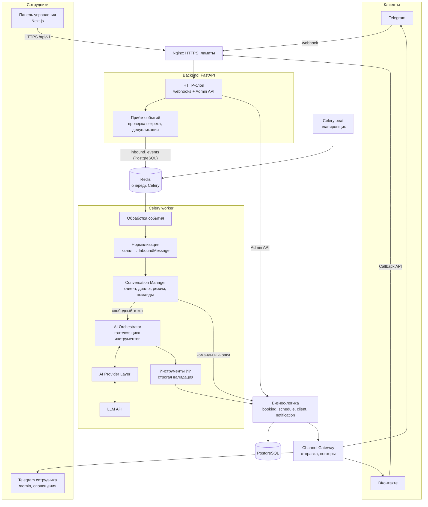
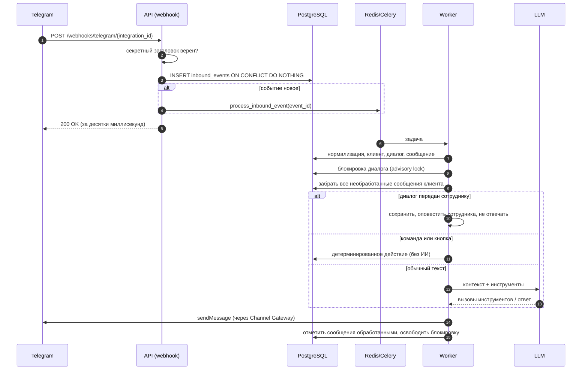
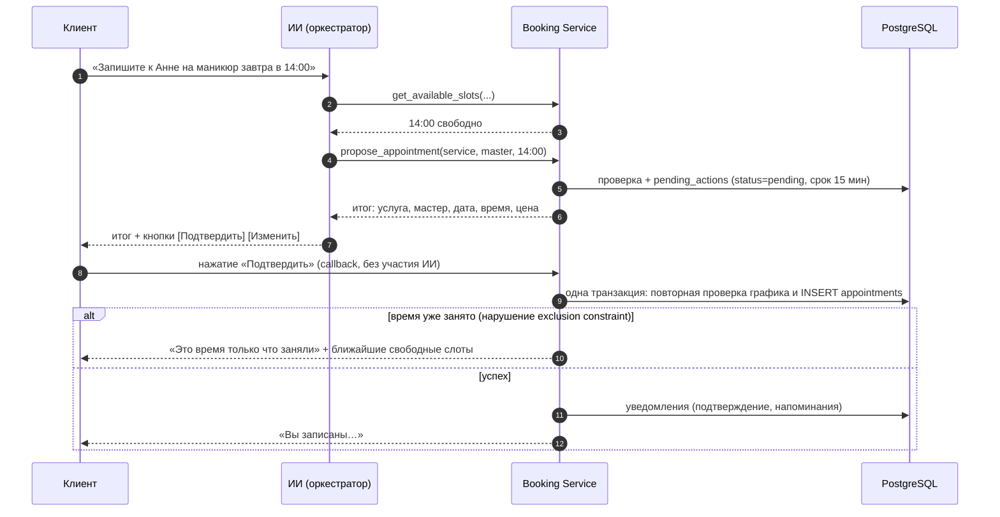

# Архитектура AI Beauty Administrator

Статус: проект (этап 0 — проектирование). Версия документа: 1.0, 2026-11-02.

## 1. Границы MVP и порядок каналов

- Первый канал — **Telegram**. ВКонтакте подключается после того, как вся цепочка
  «Telegram → ИИ → запись → уведомления → панель» работает (см. [plan.md](plan.md)).
- Архитектура с самого начала не зависит от канала: Telegram и VK — это адаптеры
  к общему конвейеру сообщений. Добавление VK не меняет бизнес-логику.
- Продукт разворачивается **отдельно для каждого салона** (своя БД, свои ключи),
  но код изначально многосалонный: у всех данных есть `salon_id`, и все запросы
  фильтруются по нему. Так одну установку можно использовать и для сети филиалов.

## 2. Общая схема



Отдельные процессы (контейнеры): `api` (FastAPI), `worker` (Celery), `beat`
(Celery beat), `frontend` (Next.js), `postgres`, `redis`, `nginx`.

## 3. Компоненты и их ответственность

| Компонент | Где в коде | Отвечает за | Не делает |
|---|---|---|---|
| Webhooks | `app/api/webhooks/` | Проверка секрета, сохранение события в `inbound_events`, постановка в очередь, быстрый ответ `200` | Не вызывает ИИ и не пишет бизнес-данные |
| Admin API | `app/api/routes/` | Авторизация, права, CRUD, аналитика | Не содержит бизнес-правил — вызывает сервисы |
| Channel adapters | `app/integrations/telegram/`, `vk/` | Разбор входящих событий в общий формат, отправка сообщений и клавиатур, ошибки API канала | Не знают о записях и ИИ |
| Channel Gateway | `app/channels/gateway.py` | Единая точка отправки: выбор адаптера, повторы, учёт ошибок, лимиты частоты | — |
| Conversation Manager | `app/conversation/manager.py` | Клиент и диалог по внешнему ID, сохранение сообщений, режим «бот/оператор», команды, кнопки подтверждения, склейка подряд идущих сообщений | Не формирует ответы ИИ |
| AI Orchestrator | `app/ai/orchestrator.py` | Сборка контекста, цикл «модель → инструмент → модель», лимиты шагов и времени, обработка отказов и сбоев LLM | Не обращается к БД напрямую — только через инструменты |
| AI Provider Layer | `app/ai/provider.py`, `app/integrations/llm/` | Общий интерфейс к LLM и адаптеры провайдеров | Не знает о салонах и записях |
| Инструменты ИИ | `app/ai/tools.py` | Pydantic-схемы аргументов, привязка к текущему клиенту и салону, вызов сервисов | Не принимают `client_id`/`salon_id` от модели |
| Бизнес-логика | `app/services/` | Расписание, свободные слоты, запись/перенос/отмена, клиенты, уведомления | Не знает, откуда пришёл запрос (API, бот, ИИ) |
| Репозитории | `app/repositories/` | Запросы к БД с обязательным `salon_id` | — |
| Планировщик | `app/workers/` | Напоминания, повторы отправки, восстановление «зависших» событий, рассылки | — |

Главное правило: **любое изменение данных проходит через `app/services/`**. И Admin API,
и кнопки в боте, и инструменты ИИ вызывают одни и те же функции сервиса записи,
поэтому проверки (рабочее время, конфликты, права) не дублируются.

## 4. Поток входящего сообщения



Почему так:

1. **Ответ вебхуку — сразу.** Ответ ИИ занимает секунды, а Telegram и VK при долгом
   ответе повторяют доставку. Сохранили событие → поставили в очередь → `200`.
2. **Дедупликация в БД.** Уникальный ключ `(integration_id, external_event_id)`:
   `update_id` в Telegram, `event_id` в VK. Повторная доставка отбрасывается вставкой
   `ON CONFLICT DO NOTHING` (проверено на PostgreSQL 16).
3. **Переживает перезапуск.** Событие лежит в БД до обработки. Если Redis или worker
   упали, периодическая задача повторно ставит в очередь события в статусе
   `received` старше 1 минуты.
4. **Порядок внутри диалога.** Сообщения одного диалога обрабатываются по одному:
   worker берёт `pg_try_advisory_lock` по ID диалога. Если блокировка занята, задача
   откладывается на пару секунд. Блокировка снимается сама при обрыве соединения.
5. **Несколько сообщений подряд** (сценарий 14.3.11). Worker забирает все
   необработанные сообщения клиента разом и отвечает одним ответом. Если пока ИИ думал,
   пришло ещё одно сообщение, после ответа цикл повторяется. Небольшая задержка
   (настройка, по умолчанию 1,5 с) собирает «очередь» коротких сообщений вместе.

## 5. Запись с подтверждением

Правило ТЗ: «ИИ предлагает → клиент подтверждает → backend повторно проверяет →
backend создаёт → клиент получает подтверждение». Подтверждение обеспечивает
backend, а не промпт:



- Кнопка обрабатывается детерминированно, без ИИ: выполняется ровно то, что было
  показано клиенту.
- Если клиент отвечает словами («да, подтверждаю»), ИИ может вызвать
  `confirm_pending_action`, но backend выполнит действие, только если оно ещё не
  истекло, принадлежит этому диалогу и итог был показан клиенту до его ответа.
- Отмена и перенос устроены так же (`propose_cancellation`,
  `propose_reschedule`).

## 6. Ключевые архитектурные решения

Формат: решение → почему → отвергнутые варианты.

**АР-1. Синхронный backend: SQLAlchemy 2 + psycopg 3, синхронные эндпоинты FastAPI,
синхронные задачи Celery.**
Нагрузка одного салона — сотни сообщений в день, долгие операции (LLM) уже вынесены в
Celery. Один синхронный код для API и worker'ов проще поддерживать и тестировать.
Отвергнуто: async SQLAlchemy + asyncpg — внутри Celery пришлось бы управлять
event loop'ами и пулами соединений, выигрыша при такой нагрузке нет.

**АР-2. Обработка сообщений — в Celery, а не в фоне FastAPI.**
Фоновые задачи FastAPI теряются при перезапуске. Celery + Redis уже есть в стеке и
нужны для уведомлений. Отвергнуто: `BackgroundTasks`, отдельная очередь на Redis Streams.

**АР-3. Двойная запись невозможна на уровне БД.**
PostgreSQL exclusion constraint по мастеру и диапазону `tstzrange(start_at, end_at, '[)')`
для всех статусов, кроме `cancelled` (подробно — в [database.md](database.md)). Проверено
на PostgreSQL 16: из 20 одновременных попыток занять одно время проходит ровно одна.
Проверка в сервисе нужна для понятного ответа клиенту, но гарантию даёт ограничение БД.

**АР-4. ИИ не может выполнить запись, отмену или перенос сам.**
Модель только создаёт «предложение» (`pending_actions`), выполняет его backend после
подтверждения клиента (раздел 5).

**АР-5. Инструменты ИИ привязаны к текущему клиенту.**
У инструментов нет параметров `client_id`, `salon_id`, `conversation_id`: оркестратор
подставляет их из контекста диалога. Модель физически не может запросить чужие записи,
даже если клиент попросит (правило 8 ТЗ).

**АР-6. История для LLM хранится в нейтральном формате.**
В БД — тексты сообщений клиента, ИИ и оператора. Провайдер-специфичные данные (блоки
вызовов инструментов, «размышления» модели) живут только внутри одного хода. Смена
провайдера не требует миграции истории. Состояние сценария (выбранная услуга, мастер,
дата, активное предложение) хранится структурированно в `conversations.state` и
передаётся модели явно.

**АР-7. Время.** Все моменты времени — `timestamptz` (UTC). Расписания (`time`, день
недели) — в часовом поясе салона (`salons.timezone`, IANA). Переводы — через `zoneinfo`.

**АР-8. Секреты.** Токены ботов и сообществ хранятся в БД зашифрованными (Fernet, ключ
только в переменной окружения `ENCRYPTION_KEY`). Секрет вебхука хранится как хеш.
Пароли — Argon2. Секреты и токены не попадают в логи (фильтр в логгере) и в промпты.

**АР-9. Человек вместо бота.** Режим диалога: `bot` → `waiting_operator` → `operator`.
В режимах оператора ИИ не отвечает. Возврат в `bot` — только явным действием сотрудника
(«Завершить передачу») или по таймауту, заданному в настройках (по умолчанию выключен).

**АР-10. Детерминированные сценарии на кнопках.** Команды `/services`, `/booking`,
`/cancel` работают без ИИ — через те же сервисы. Это и запасной путь, когда LLM
недоступен, и способ проверить канал Telegram до подключения ИИ.

## 7. Структура проекта

Структура из ТЗ сохраняется. Дополнения (выделены «+») — ради разделения ответственности:

```
ai-beauty-administrator/            ← корень репозитория
├── backend/
│   ├── app/
│   │   ├── main.py, config.py
│   │   ├── api/routes/             auth, salon, clients, masters, services,
│   │   │                           appointments, schedules, analytics, conversations,
│   │   │                           + integrations, + users, + campaigns
│   │   ├── api/webhooks/           telegram.py, vk.py
│   │   ├── core/                   security, permissions, exceptions, logging
│   │   ├── models/                 SQLAlchemy-модели (см. database.md)
│   │   ├── schemas/                Pydantic-схемы API
│   │   ├── repositories/           запросы с обязательным salon_id
│   │   ├── services/               booking, schedule, client, notification,
│   │   │                           + availability (расчёт слотов), + campaign
│   │   ├── + conversation/         manager.py, commands.py, actions.py (pending_actions)
│   │   ├── + channels/             types.py (InboundMessage, OutboundMessage, Keyboard),
│   │   │                           gateway.py (отправка, повторы, лимиты)
│   │   ├── ai/                     orchestrator, provider, prompts, tools, intent, context
│   │   ├── integrations/
│   │   │   ├── telegram/           client.py, adapter.py, keyboards.py
│   │   │   ├── vk/                 client.py, adapter.py, keyboards.py
│   │   │   └── llm/                anthropic.py (+ адаптеры других провайдеров)
│   │   ├── workers/                celery_app, inbound, reminders, campaigns, outbound
│   │   └── db/                     session.py, base.py
│   ├── migrations/                 Alembic
│   ├── tests/                      unit/, integration/, ai_eval/, load/
│   ├── requirements.txt            точные версии (pip-compile из requirements.in)
│   └── Dockerfile
├── frontend/                       Next.js + TypeScript + Tailwind
├── infrastructure/nginx/
├── docs/
├── docker-compose.yml              локальная разработка и продакшен (профили)
├── .env.example, .gitignore, README.md
```

Текущий прототип VK-бота в корне репозитория (`bot/`, `tests/`, `Dockerfile` и др.)
на этапе 1 заменяется этой структурой. Он остаётся в истории git.

## 8. Нефункциональные требования (оценки для MVP)

| Параметр | Цель |
|---|---|
| Ответ вебхуку | < 200 мс (p95) |
| Ответ клиенту без ИИ (кнопки, команды) | < 2 с |
| Ответ ИИ | обычно 3–15 с; клиент видит «печатает…»; предел хода 60 с |
| Масштаб одной установки | до 5 филиалов, 50 мастеров, 2 000 сообщений в день |
| Доступность | один сервер, перезапуск без потери входящих событий |
| Резервные копии | ежедневно + хранение вне сервера (см. deployment.md) |
