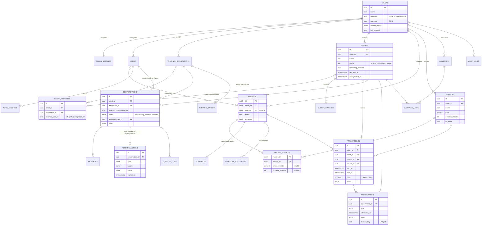

# База данных

PostgreSQL 16, миграции — Alembic (одна миграция на каждое изменение структуры).
Расширения: `btree_gist` (для ограничения против пересечения записей).
`gen_random_uuid()` встроен в PostgreSQL 13+.

## 1. Общие правила

- Первичный ключ — `id uuid DEFAULT gen_random_uuid()`.
- У основных таблиц есть `created_at` и `updated_at` (`timestamptz`, `updated_at`
  обновляется ORM-ом). У журналов (`messages`, `audit_logs`, `ai_usage_logs` и т. п.)
  только `created_at`: записи в них не меняются.
- Все таблицы с данными салона содержат `salon_id NOT NULL`.
- **Изоляция салонов на уровне БД.** У родительских таблиц есть `UNIQUE (salon_id, id)`,
  а дочерние ссылаются составным ключом `FOREIGN KEY (salon_id, master_id) REFERENCES
  masters (salon_id, id)`. Запись физически не может сослаться на мастера, услугу или
  клиента другого салона (проверено: такая вставка отклоняется ошибкой внешнего ключа).
  Дополнительно каждый запрос в репозиториях фильтруется по `salon_id` из токена или
  интеграции.
- Деньги — `numeric(10,2)`, валюта — в `salons.currency` (ISO 4217, по умолчанию `RUB`).
- Моменты времени — `timestamptz`. Время по расписанию (`time`) и дата (`date`) —
  в часовом поясе салона.
- Перечисления — PostgreSQL `ENUM` (новые значения добавляются миграцией).
- Телефон хранится нормализованным в E.164 (`+79991234567`).

## 2. ER-диаграмма



## 3. Таблицы

Ниже — поля сверх `id`, `created_at`, `updated_at`. Поля, которых нет в ТЗ,
помечены «+» с объяснением.

### 3.1. Салон и сотрудники

**salons** — `name`, `description`, `address`, `phone`, `timezone` (IANA, проверяется
через `zoneinfo`), `currency char(3)`, `working_hours jsonb` (часы работы салона для
справки клиентам, формат `{"1": [["10:00","21:00"]], ...}`, ключи — дни недели ISO),
`bot_enabled bool`.

**salon_settings** (1 : 1 с салоном, `UNIQUE(salon_id)`):

| Поле | По умолчанию | Назначение |
|---|---|---|
| `slot_step_minutes` | 15 | Шаг сетки свободных слотов |
| `min_lead_minutes` | 60 | Нельзя записаться раньше, чем через N минут |
| `booking_horizon_days` | 30 | Насколько вперёд открыта запись |
| `buffer_minutes` | 0 | Пауза после записи (уборка, подготовка) |
| `auto_confirm` | true | `true` → запись сразу `confirmed`, `false` → `pending` до подтверждения сотрудником |
| `require_phone` | true | Перед первой записью попросить телефон |
| `min_cancel_notice_hours` | 3 | Позже этого срока клиент не может отменить сам — только через сотрудника |
| `cancellation_policy` | — | Текст правил отмены для клиентов и ИИ |
| `tone` | `friendly` | Тон ИИ: `friendly`, `neutral`, `formal` |
| `greeting_text`, `extra_info` | — | Приветствие; доп. сведения (парковка, оплата, FAQ) для ИИ |
| `privacy_policy_url` | — | Ссылка на политику обработки ПДн |
| `notification_settings jsonb` | — | По каждому типу уведомления: включено, смещение, шаблон текста |
| `operator_return_minutes` | null | + Автовозврат диалога боту через N минут без ответа сотрудника (null — выключено) |

**users** — `salon_id`, `name`, `email` (уникален), `password_hash` (Argon2), `role`
(`owner`, `administrator`, `master`), `is_active`, `last_login`,
`telegram_user_id bigint` (+, для `/admin` и оповещений в Telegram; уникален в салоне),
`vk_user_id bigint` (+, то же для VK).

**auth_sessions** (+, нужна для refresh-токенов и выхода) — `user_id`,
`refresh_token_hash` (SHA-256), `expires_at`, `revoked_at`, `user_agent`, `ip`.
При обновлении токена старая запись отзывается, создаётся новая (ротация); повторное
использование отозванного токена отзывает все сессии пользователя.

### 3.2. Клиенты

**clients** — `name`, `phone`, `source` (`telegram`, `vk`, `admin`, `import`), `notes`,
`marketing_consent bool`, `pd_consent_at` (+, когда дано согласие на обработку ПДн),
`last_visit_at`, `anonymized_at` (+, клиент удалён по запросу).
Частичный уникальный индекс `UNIQUE (salon_id, phone) WHERE phone IS NOT NULL`.

Отличие от ТЗ: полей `telegram_id` и `vk_id` в `clients` нет. Связь с каналами хранится
только в `client_channels`, иначе два места хранения одного факта рано или поздно
разойдутся.

**client_channels** — `salon_id`, `client_id`, `integration_id`, `channel`
(`telegram`, `vk`), `external_user_id text`, `username`, `display_name`,
`is_reachable bool` (+, `false` если пользователь заблокировал бота).
`UNIQUE (integration_id, external_user_id)`.

Правила объединения клиентов: по имени — никогда. Автоматически — только если телефон
подтверждён каналом (в Telegram — кнопка «Поделиться контактом», где
`contact.user_id` совпадает с отправителем) и в салоне ровно один клиент с этим
телефоном без аккаунта в этом канале. В остальных случаях создаётся новый клиент.

**client_consents** (+, журнал согласий для 152-ФЗ) — `client_id`, `type`
(`personal_data`, `marketing`), `granted bool`, `policy_version`, `source` (канал или
сотрудник), `created_at`. Только добавление записей; текущее состояние дублируется в
`clients` для быстрых выборок.

Удаление клиента по запросу — **обезличивание**: имя, телефон, заметки и тексты
сообщений стираются, `client_channels` удаляются, записи остаются для статистики без
персональных данных.

### 3.3. Мастера, услуги, расписание

**masters** — `user_id` (nullable), `name`, `description`, `photo_url`, `is_active`,
`sort_order` (+).

**services** — `name`, `description`, `price numeric(10,2)`, `duration_minutes`
(5–720), `category`, `is_active`, `sort_order` (+).

**master_services** — `salon_id`, `master_id`, `service_id`, `UNIQUE(master_id, service_id)`,
`price_override`, `duration_override` (+, nullable). У топ-мастера цена и длительность
часто отличаются. Без этих полей ИИ называл бы неверную цену. Если override пуст —
берутся значения услуги.

**schedules** — `master_id`, `weekday smallint` (1 = понедельник … 7 = воскресенье),
`start_time`, `end_time`, `break_start`, `break_end`, `is_working`.
`UNIQUE (master_id, weekday)`; проверки: `end_time > start_time`, перерыв внутри смены.

**schedule_exceptions** — `master_id`, `date`, `start_time`, `end_time`, `type`
(`vacation`, `day_off`, `sick_leave`, `custom_hours`, `extra_shift`), `description`.
`UNIQUE (master_id, date)`. Для `vacation`/`day_off`/`sick_leave` время пустое (весь
день нерабочий), для `custom_hours`/`extra_shift` — обязательно. Отпуск на несколько
дней панель создаёт как набор строк по дням.

### 3.4. Записи

**appointments** — `client_id`, `master_id`, `service_id`, `start_at`, `end_at`,
`price` (снимок цены на момент записи), `status`, `source` (`telegram`, `vk`, `admin`),
`comment`, `cancellation_reason`, `cancelled_at` (+), `cancelled_by` (+, `client` /
`salon`), `created_by_user_id` (+, если запись создал сотрудник).

Защита от пересечений (DDL проверен на PostgreSQL 16):

```sql
CREATE EXTENSION IF NOT EXISTS btree_gist;

ALTER TABLE appointments
  ADD CONSTRAINT appointments_time_valid CHECK (end_at > start_at),
  ADD CONSTRAINT appointments_no_overlap EXCLUDE USING gist (
      master_id WITH =,
      tstzrange(start_at, end_at, '[)') WITH &&
  ) WHERE (status <> 'cancelled');
```

Результаты проверки на PostgreSQL 16:

| Случай | Результат |
|---|---|
| 10:00–11:00, затем 10:30–11:30 у того же мастера | второе отклонено (`23P01`) |
| 10:00–11:00 и 11:00–12:00 (встык) | обе записи приняты |
| Отменённая запись на занятое время | принята — `cancelled` не блокирует |
| Вернуть отменённую запись в `confirmed`, если время уже занято | отклонено |
| Перенос записи на занятое время | отклонено |
| 20 одновременных транзакций на одно время | прошла 1, отклонено 19 |
| Ссылка на мастера другого салона | отклонено внешним ключом |

`end_at` = `start_at` + длительность (с учётом `duration_override`) + `buffer_minutes`
из настроек салона. Буфер входит в занятый интервал, поэтому следующая запись не
встанет вплотную.

Сервис записи ловит нарушение ограничения (`sqlalchemy.exc.IntegrityError` с SQLSTATE
`23P01`) и превращает его в бизнес-ошибку `SlotTakenError` → HTTP 409 в API или
предложение других слотов в боте.

Общие ресурсы (кресло, кабинет, аппарат) в MVP не моделируются: считается, что
пересекаться не должны только записи одного мастера (см. [risks.md](risks.md)).

Индексы: `(salon_id, start_at)`, `(master_id, start_at)`, `(client_id, start_at)`.

### 3.5. Каналы и диалоги

**channel_integrations** — `channel` (`telegram`, `vk`), `name`, `is_active`,
`credentials_encrypted bytea` (токен бота или сообщества, Fernet),
`webhook_secret_hash` (SHA-256 секрета вебхука / секретного ключа VK),
`external_account_id` (ID бота или сообщества), `settings jsonb` (имя бота, строка
подтверждения VK), `last_error`, `last_error_at`.

**conversations** — `client_id`, `integration_id`, `channel`, `external_conversation_id`
(chat_id / peer_id), `status` (`bot`, `waiting_operator`, `operator`),
`assigned_user_id`, `handoff_reason` (+), `handoff_at` (+), `last_message_at`,
`state jsonb` (+, состояние сценария для ИИ), `summary` (+, краткое содержание старой
части переписки), `last_intent` (+, для аналитики).
`UNIQUE (integration_id, external_conversation_id)`.

Отличие от ТЗ: статуса «closed» нет. Диалог в мессенджере не заканчивается: клиент
может написать снова. «Закрыть» означает «вернуть боту» (`status = bot`).

**messages** — `salon_id` (+), `conversation_id`, `role` (`client`, `assistant`,
`operator`, `system`), `content`, `external_message_id`, `payload jsonb` (+, данные
кнопки, контакт, сведения о вложениях), `processed_at` (+, для входящих: когда
обработано), `delivery_status` (+, для исходящих: `pending`, `sent`, `failed`),
`delivery_attempts` (+), `delivery_error` (+), `sent_by_user_id` (+, сотрудник).
Индекс `(conversation_id, created_at)`.

**inbound_events** (+, приём вебхуков) — `integration_id`, `external_event_id`
(`update_id` / `event_id`), `payload jsonb`, `status` (`received`, `processed`,
`ignored`, `failed`), `error`, `processed_at`.
`UNIQUE (integration_id, external_event_id)`. Хранятся 30 дней.

**pending_actions** (+, предложения на подтверждение) — `conversation_id`, `client_id`,
`type` (`create_appointment`, `cancel_appointment`, `reschedule_appointment`),
`params jsonb`, `summary`, `status` (`pending`, `confirmed`, `rejected`, `expired`,
`failed`), `expires_at` (по умолчанию +15 мин), `shown_message_id` (сообщение с
итогом), `result_appointment_id`, `resolved_at`.
Частичный уникальный индекс `UNIQUE (conversation_id) WHERE status = 'pending'`: новое
предложение переводит старое в `expired`.

### 3.6. Уведомления и рассылки

**notifications** — `client_id`, `appointment_id`, `channel`, `type`
(`booking_confirmation`, `reminder_24h`, `reminder_2h`, `cancellation_confirmation`,
`reschedule_notice`, `free_slot_offer`, `staff_alert`), `scheduled_at`, `sent_at`,
`status` (`scheduled`, `sending`, `sent`, `failed`, `cancelled`, `skipped`),
`attempts` (+), `error_message`, `dedupe_key text UNIQUE` (+).

`dedupe_key` строится из события, например `appt:{id}:reminder_24h:{start_at}`.
Повторное планирование того же напоминания ничего не создаёт (`ON CONFLICT DO NOTHING`),
а после переноса у записи новый `start_at` → новый ключ, старое напоминание отменяется.

**campaigns** (+, нужна для подтверждения рассылки владельцем) — `segment`, `template`,
`status` (`draft`, `approved`, `sending`, `done`, `cancelled`), `created_by_user_id`,
`approved_by_user_id`, `approved_at`, `stats jsonb`.

**campaign_logs** — `campaign_id`, `client_id`, `status`, `error`, `sent_at`.
`UNIQUE (campaign_id, client_id)` — один клиент получает рассылку один раз.

### 3.7. Журналы

**ai_usage_logs** — `conversation_id`, `provider`, `model`, `operation`
(`generate_with_tools`, `classify_intent`, `summarize`), `input_tokens`,
`output_tokens`, `cache_read_tokens`, `cache_write_tokens`, `cost_estimate numeric`,
`latency_ms`, `stop_reason`, `tool_calls jsonb` (имена, аргументы, результат проверки),
`error`, `request_id`.

**audit_logs** — `actor_type` (`user`, `client`, `ai`, `system`), `actor_id`, `action`
(`appointment.create`, `client.update`, `conversation.assign`…), `entity_type`,
`entity_id`, `changes jsonb` (до/после, без секретов), `ip`.

## 4. Расчёт свободных слотов

Функция `availability.get_slots(salon, service, master | любой, date)`:

1. Рабочий интервал мастера на дату: исключение на эту дату (если есть) иначе недельный
   график; минус перерыв.
2. Длительность = `duration_override` мастера или длительность услуги; занимаемый
   интервал = длительность + `buffer_minutes`.
3. Занятые интервалы: записи мастера на эту дату со статусом ≠ `cancelled`.
4. Кандидаты: от начала смены с шагом `slot_step_minutes`; слот подходит, если
   `[start, start + занимаемый)` целиком внутри рабочего интервала и не пересекается с
   занятыми.
5. Отсечь слоты раньше `now + min_lead_minutes` и позже горизонта записи.
6. «Любой мастер»: объединение слотов всех активных мастеров, оказывающих услугу; при
   подтверждении выбирается первый свободный мастер на это время.

Всё считается в часовом поясе салона, результат хранится и передаётся в UTC.

## 5. Миграции

- Первая миграция создаёт расширение `btree_gist`, перечисления и все таблицы этапа 2.
- Каждое изменение структуры — отдельная ревизия Alembic с `downgrade`.
- Проверка в CI: `alembic upgrade head` на чистой БД, затем `alembic check`
  (модели и миграции не расходятся).
